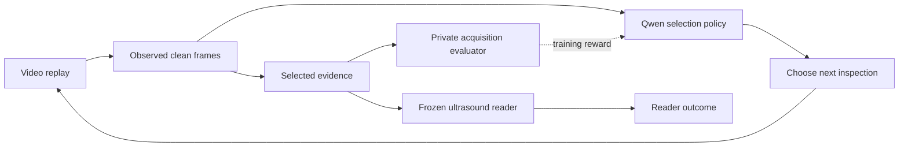
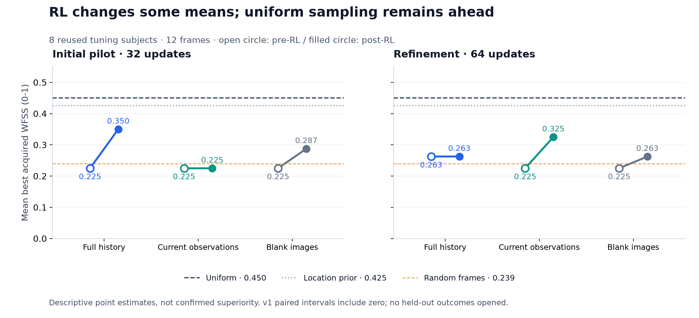

# SonoMed ActiveReader

**Can an ultrasound agent learn which frames to inspect—and does visual history help?**

[](https://github.com/jxia622/SonoMed-ActiveReader/actions/workflows/tests.yml)
[](LICENSE)
[](docs/RESULTS.md)

A research pipeline for **budgeted ultrasound evidence selection**. A trainable Qwen3-VL policy navigates a video; a separate, frozen ultrasound reader evaluates selected clean frames. The project includes replay environments, GRPO training, matched sampling baselines, visual-history controls, and input-level audits.

**Current finding · October 11, 2026:** the pipeline works, but a reliable RL advantage over strong sampling baselines has **not** been demonstrated. An initial ACOUSLIC pilot improved over its starting policy and had a higher mean than random sampling, but remained below uniform sampling. The latest refinement did not improve the full-history policy. Test outcomes remain sealed.

[Results & interpretation](docs/RESULTS.md) · [Dataset audit](docs/DATASETS.md) · [How it works](docs/METHODS.md) · [Reproduce & inspect](docs/REPRODUCIBILITY.md)

## The research question

Most ultrasound video frames are never read by a model with a small image budget. We ask whether an agent can spend that budget better by revisiting promising regions and using what it has already seen.



The policy cannot inspect annotation masks, hidden frames, diagnostic labels, or another rollout's observations. Acquisition quality and reader performance are separate endpoints.

## Current results

ACOUSLIC uses **12 unique frames per scan**, with 32 training subjects and eight tuning subjects. The score below is the best annotation-supported plane quality among the acquired frames, averaged within subjects. It ranges from 0 to 1; higher is better. It is **not diagnostic accuracy or the official challenge's single-frame score**.

| Method | Initial pilot · v1 | Refinement · v2b |
|---|---:|---:|
| Uniform sampling | **0.4500** | **0.4500** |
| Training-only location prior | 0.4250 | 0.4250 |
| Coverage sampling | 0.3500 | 0.3500 |
| Full-history Qwen after RL | 0.3500 | 0.2625 |
| Current-observation Qwen after RL | 0.2250 | 0.3250 |
| Blank-image Qwen after RL | 0.2875 | 0.2625 |
| Random inspection actions | 0.2830 | 0.2830 |
| Random frames | 0.2393 | 0.2393 |

The sampling baselines are the same development references in both columns. v1 and v2b use different action representations and training objectives; they are distinct experiments. All trained arms are shown, including negative results.



- **Learning:** v1 full history rose from 0.2250 to 0.3500. The paired 95% interval for its advantage over random frames includes zero. v2b current observations rose from 0.2250 to 0.3250; v2b full history stayed at 0.2625.
- **History:** hiding older images changed 8/16 second actions in the v1 intervention, but no acquisition scores changed. There is no demonstrated benefit from previous visual observations.
- **Dataset fit:** BreastVid has valid lesion boxes in 97.68% of analyzed frames. ACOUSLIC offers a sparser acquisition target: 2.13% of training frames have supported-plane annotations. Neither statistic establishes diagnostic sufficiency.
- **Evaluation scope:** eight repeatedly used tuning subjects, one training seed per campaign, no held-out performance claims. Both development gates failed.

Read [the full report](docs/RESULTS.md) for matched pre-RL controls, uncertainty, reward diagnostics, and the failed engineering attempt between campaigns. Numerical summaries are available in [JSON and CSV](results/README.md).

## Try it locally

The small demo exercises the actual acquisition environment using synthetic scores. It needs no model, medical images, GPU, or network access after installing NumPy.

```bash
git clone https://github.com/jxia622/SonoMed-ActiveReader.git
cd SonoMed-ActiveReader
python3 -m venv .venv
source .venv/bin/activate
python -m pip install 'numpy>=1.26,<3'
python scripts/demo_acquisition.py
```

For the complete source tests and figure regeneration, use Python 3.11–3.13:

```bash
python -m pip install -e '.[dev,viz]'
python -m pytest -q
python scripts/plot_public_results.py
```

The tests use synthetic inputs and randomly initialized tiny model fixtures. They do not download pretrained weights or read the sealed datasets. See [reproducibility](docs/REPRODUCIBILITY.md) for the verified environment and the boundary between executable software tests and numerical experiment replication.

## What's here

| Path | Purpose |
|---|---|
| [`src/sonomed_vlm/active_reader/`](src/sonomed_vlm/active_reader/) | Replay, selection policies, frozen reader, GRPO, dataset safeguards |
| [`src/sonomed_vlm/active_reader/acouslic/`](src/sonomed_vlm/active_reader/acouslic/) | Sweep navigation, acquisition scoring, baselines, training |
| [`scripts/`](scripts/) | Experiment runners, input audits, analysis, public demo |
| [`tests/`](tests/) | Budgets, split guards, causal history, probabilities, credit assignment |
| [`docs/`](docs/) | Findings, methods, dataset selection, reproducibility |
| [`results/`](results/) | Reviewed aggregate results; no individual clinical records |
| [`protocols/`](protocols/) | Historical protocol records and their provenance |
| [`configs/`](configs/) | Portable examples without local infrastructure paths |

## Data, models, and provenance

The work builds on [SonoMed-VLM](https://github.com/jxia622/SonoMed-VLM) and the [Qwen3-VL-4B-Instruct base model](https://huggingface.co/Qwen/Qwen3-VL-4B-Instruct). The existing ultrasound adapter used in the experiments is **not distributed here**. Exact replication of the reported model results requires that adapter and the original admitted split records.

Obtain BreastVid and ACOUSLIC from their original publishers under their respective terms. This repository publishes source, aggregate findings, and figures—not medical images, annotations, patient manifests, model weights, native input traces, or private cluster configuration. Public dataset correction identifiers remain in the source to preserve the authors' errata.

Code is available under [Apache 2.0](LICENSE). Dataset and model terms are separate; see [third-party notices](THIRD_PARTY_NOTICES.md). This is exploratory research software and has not been clinically validated.

## Next research milestone

Establish a repeatable development advantage over **uniform sampling and the location prior**, then isolate an incremental visual-history benefit at matched budgets. Freeze the method and evaluation plan before opening any held-out outcomes. Current evidence supports further controlled investigation, not a claim that RL navigation already wins.
