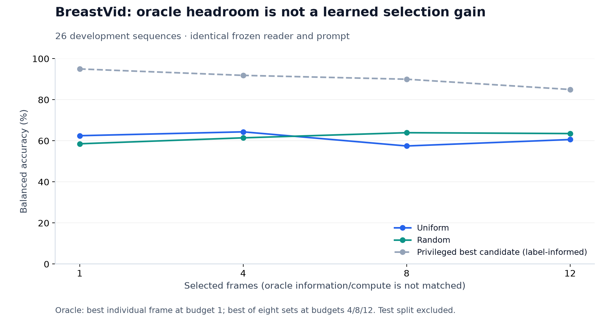

# Dataset suitability and route selection

**ACOUSLIC is the current acquisition research route.** Its longer blind sweeps and sparse supported-plane labels create more room for budgeted inspection than lesion-presence search in BreastVid. Current experiments still do not establish that this room can be exploited by history-aware RL.

## BreastVid audit

The admitted inventory contains 171 sequences. Content analysis excludes all 26 sealed test sequences and covers **119 training + 26 development sequences**, totaling 19,599 frames. This is the corrected, quarantined project partition, not the original publisher's split. Patient independence and overlap with the ultrasound SFT corpus remain unresolved.

The [CVA-Net author release](https://github.com/jhl-Det/CVA-Net) provides the data and public corrections. Its original benchmark is lesion detection, whereas our reader study uses video classification. These results are not comparable to the paper's detection average precision.

### Length and timing

| Split | N | Min | P5 | P10 | P25 | Median | Mean | P75 | P90 | P95 | Max |
|---|---:|---:|---:|---:|---:|---:|---:|---:|---:|---:|---:|
| Train | 119 | 28 | 45.6 | 52.8 | 76.5 | 120 | 131.5 | 169.5 | 226.4 | 254.7 | 390 |
| Development | 26 | 37 | 39.0 | 41.0 | 76.5 | 134.5 | 151.7 | 202.3 | 275.0 | 301.8 | 375 |
| Combined | 145 | 28 | 41.2 | 49.8 | 76.0 | 123 | 135.2 | 180.0 | 242.8 | 265.8 | 390 |

Values count extracted frames; percentiles use linear interpolation. Reliable duration is unavailable: the permitted release records and decoded image metadata contain no usable FPS or acquisition timestamps. Contiguous filenames do not establish frame rate.

### Lesion visibility and redundancy

| Measure | Training/development result |
|---|---:|
| Frames with valid lesion boxes | 19,144 / 19,599 (97.68%) |
| Frames with unknown visibility | 455 (invalid box geometry) |
| Explicitly annotated lesion-free frames | 0 |
| Sequences with valid boxes in every frame | 114 / 145 |
| Median normalized union box area | 12.44% |
| Box area P25 / P75 | 7.62% / 20.00% |
| Median within-sequence area coefficient of variation | 25.9% |
| Median adjacent central-crop SSIM | 0.965 |
| Median half-sequence-lag central-crop SSIM | 0.231 |
| Median adjacent embedding cosine similarity | 0.984 |
| Median half-sequence-lag embedding cosine similarity | 0.903 |

Every unknown frame has a raw box record with invalid geometry; these are neither missing image records nor verified negative frames. Invalid boxes are excluded from area statistics. Box unions avoid double counting. Annotation-supported presence does not prove diagnostic adequacy.

The similarity measures indicate high local redundancy and more variation over longer intervals. SSIM uses 128×128 grayscale inputs with a seven-pixel window; the crop reduces static border influence. Embedding similarity is a perceptual proxy, not a count of independent clinical observations. These measures do not justify treating frames as independent samples.

### Frozen-reader headroom

The same ultrasound reader and ordinal-only prompt were used across 26 development sequences (10 benign, 16 malignant). Balanced accuracy averages the two class recalls. Random sets use three predeclared seeds, except the single-frame expectation over all frames.

| Selection | 1 frame | 4 frames | 8 frames | 12 frames |
|---|---:|---:|---:|---:|
| Uniform, middle frame at budget 1 | 62.50% | 64.38% | 57.50% | 60.63% |
| Random | 58.56% | 61.46% | 63.96% | 63.54% |
| Privileged largest-box areas | — | 64.38% | 70.63% | 68.75% |
| Privileged best candidate | 95.00% | 91.88% | 90.00% | 85.00% |

For budgets 4/8/12, the privileged choice is the best of eight candidates: one uniform set, three random sets, and four contiguous windows. Candidates are constructed without diagnoses; selecting the winner uses the true diagnosis. Budget 1 chooses among every individual frame. These oracle results use additional information and computation beyond the selected-frame budget.

Dense individual-frame probability pooling scored **56.25%** and dense batch pooling **59.38%**, using a mean of 151.7 frames per development sequence. Neither is a joint full-video attention model or a guaranteed upper bound. The 12-frame random-minus-uniform difference was +2.92 percentage points, with paired 95% interval [−8.33, +16.01].

Frame choice can affect reader outputs. That alone does not show that previous observations predict which next action will help. A group-disjoint, training-only probe found no clear full-history advantage over latest observations: evidence-log-score difference +0.0021, interval [−0.0667, +0.0939], with equal correctness of 65.63%.

## Why ACOUSLIC was selected

The [public ACOUSLIC-AI v1.1 training release](https://zenodo.org/records/12697994) contains prenatal blind-sweep ultrasound with abdominal measurement-plane annotations. Version 1.1 corrects circumference values from the earlier release. Data are separately licensed under CC BY-NC-SA 4.0. [Dataset documentation](https://acouslic-ai.grand-challenge.org/datasets/).

The admitted pilot uses 60 subjects, one deterministically selected scan per subject, split 32/8/20 into training/tuning/sealed evaluation. Each prepared scan has 840 frames, grouped into six sweeps. Among training scans, **573/26,880 frames (2.13%)** have supported-plane annotations. Zero annotations do not prove anatomical absence; the target is annotation-supported acquisition.

This is a clearer search task than finding a lesion that is annotated almost everywhere. It also has a direct evaluator for candidate quality. However, uniform and location-prior baselines remain stronger than our current learned policies. Sparse annotations create potential headroom, not a guarantee of a learnable history signal.

## Alternatives screened

These are screening conclusions, not full admissions or comparative model results. Access status reflects the investigation at this snapshot.

| Route | Finding | Decision |
|---|---|---|
| [TNVideo / OpenThyroidDB](https://huggingface.co/datasets/MedXAgent/ThyroidOpenDB) | Access approval required; no approved data access available during screening | Defer |
| [MIMIC-IV-Echo](https://physionet.org/content/mimic-iv-echo/1.0.1/) | Credentialing and data-use requirements; attractive multi-view setting | Longer-term route |
| [TCIA B-mode and CEUS liver](https://www.cancerimagingarchive.net/collection/b-mode-and-ceus-liver/) | Public clinical linkage, but class imbalance and unverified frame/phase supervision in inspected examples | Slower alternative |
| [Focal liver lesions in CEUS](https://github.com/lemondan/Focal-liver-lesions-dataset-in-CEUS) | Public examples with longer temporal sequences; phase labels, complete cohort admission, and reader suitability need verification | Temporal-diagnosis fallback |

If ACOUSLIC cannot show reliable conditional gains over geometry and coverage controls, prioritize a dataset with verified phase transitions or complementary views. Length alone is not enough: first establish reader competence, matched-budget selection headroom, and incremental information from history.
